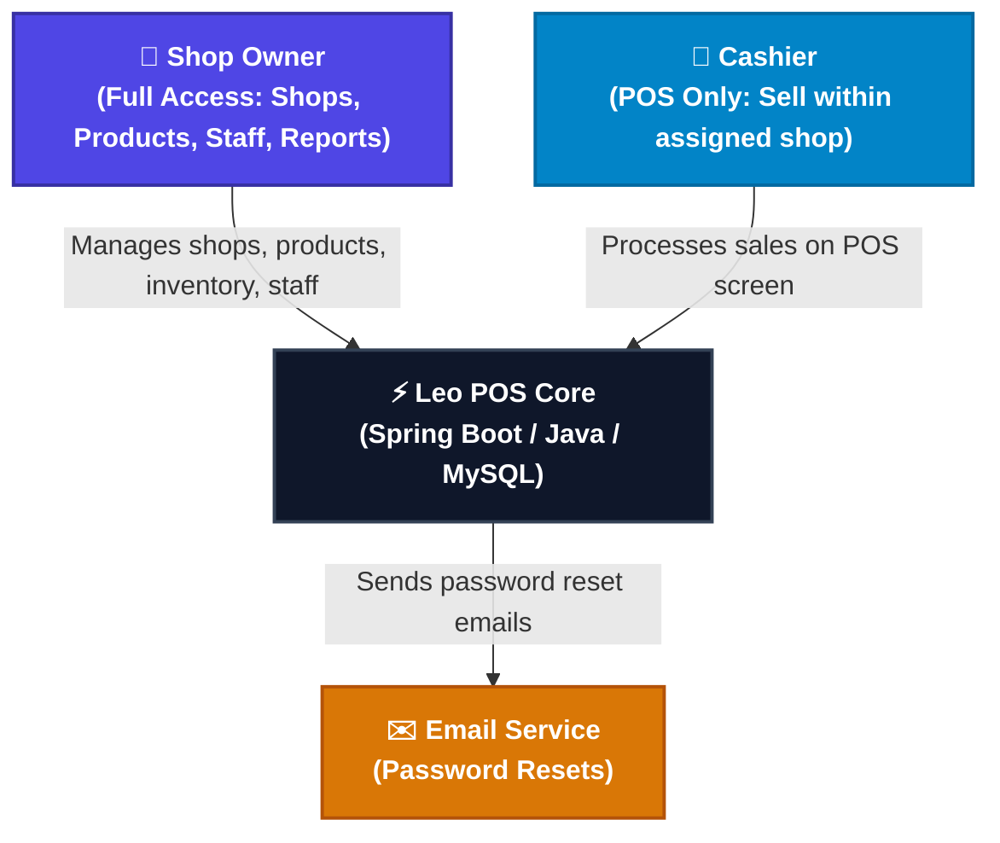

# Software Requirements Specification (SRS)
## Leo — Retail Point of Sale (POS) System
**Document Version:** 1.1
**SDLC Stage:** MVP Specification
**Status:** Updated for financial workflow implementation

---

## 1. Introduction

### 1.1 Purpose
This Software Requirements Specification (SRS) document provides the complete, authoritative specification of the functional, non-functional, security, and architectural requirements for **Leo** — a multi-tenant, multi-shop retail Point of Sale (POS) system. It serves as the primary blueprint for engineering, quality assurance, and product delivery.

### 1.2 Scope of the System
**Leo** is a web-based SaaS POS platform designed for retail shop owners in Kenya and similar markets. The platform:
- Enables shop owners to manage **one or more shops** (hardware, agrovet, general retail, etc.) from a single account.
- Provides **cashiers** with a fast, simple POS interface for processing sales.
- Gives **owners** full visibility into products, inventory, staff, and sales reports.
- Tracks customers and prior sales independently from customer debts, and records debt repayments, operating expenses, stock withdrawals, and owner drawings.
- Maintains shop cash/account balances separately from operating profit so owners can distinguish business cash from earnings and drawings.
- Is built to handle cash payments in the MVP, with M-Pesa STK Push integration in a future phase.
- Is structured as a **tiered SaaS product** — a single shop in the starter plan, multiple shops/departments in higher plans.

### 1.3 Target Users & Roles

| Role | Description |
|---|---|
| **Owner** | Full system access — manages shops, products, staff, inventory, and views all reports |
| **Cashier** | Restricted POS access — can process sales only within their assigned shop |

### 1.4 Definitions & Abbreviations
- **Shop**: A business unit (e.g. hardware store, agrovet, retail outlet) owned by one owner
- **Product**: An item available for sale in a shop with name, price, category, and stock quantity
- **Sale / Transaction**: A completed checkout event with one or more line items
- **Sale Item**: A single product line within a sale (product, quantity, subtotal)
- **Stock**: Quantity of a product available in a shop
- **Low Stock**: When a product's quantity falls at or below its defined minimum stock threshold
- **Customer Debt**: A customer balance recorded independently from a sale. A debt never changes or identifies a sale.
- **Owner Drawing**: Cash removed from a shop account for the owner; it reduces available cash and remaining distributable profit, but is not an operating expense.
- **Shop Account**: A per-shop cash-flow ledger that records opening capital and subsequent cash inflows/outflows.
- **SRS**: Software Requirements Specification
- **POS**: Point of Sale
- **RBAC**: Role-Based Access Control

---

## 2. System Architecture & Context

### 2.1 System Context Diagram

---

## 3. Detailed Functional Requirements

### 3.1 Authentication & RBAC (FR-AUTH)

- **FR-AUTH-1 (Bootstrap Admin):**
  The first user to register on the system is automatically provisioned as **Owner** with `ACTIVE` status and full access — no approval required.

- **FR-AUTH-2 (Cashier Registration & Approval):**
  Subsequent registrations default to `PENDING`. The Owner approves and assigns the `CASHIER` role and links the cashier to one or more shops.

- **FR-AUTH-3 (Role-Based Route Guards):**
  - `OWNER`: Access to all routes — dashboard, shops, products, inventory, staff management, sales reports.
  - `CASHIER`: Access to POS screen only within their assigned shop(s).

- **FR-AUTH-4 (Password Recovery):**
  Users can request a password reset via email. System generates a cryptographic token valid for **15 minutes** and delivers a recovery link via email.

- **FR-AUTH-5 (Temporary Identity Header):**
  Until the separate security-hardening phase, the frontend sends the logged-in user's ID in `X-User-Id`. The backend loads the active user and role from the database; `X-User-Role` is not authoritative. This temporary identity mechanism is not secure against a caller who can forge headers and must be replaced before production.

---

### 3.2 Shop Management (FR-SHOP)

- **FR-SHOP-1 (Shop Creation):**
  Owner can create one or more shops with: name, type (General Retail / Hardware / Agrovet / Other), description, and location.

- **FR-SHOP-2 (Shop Isolation):**
  Each shop maintains its own independent product catalogue, stock levels, and sales history. A product in Shop A does not appear in Shop B.

- **FR-SHOP-3 (Multi-Shop Scoping):**
  Owner dashboard aggregates metrics across all owned shops. Cashier dashboard scopes to only their assigned shop(s).

- **FR-SHOP-4 (Plan-Based Shop Limits):**
  - `STARTER` plan: 1 shop maximum.
  - `BUSINESS` plan: Up to 3 shops (multiple departments under one roof).
  - `ENTERPRISE` plan: Unlimited shops and branches.
  *(Plan enforcement is a future billing feature — MVP creates one shop per owner.)*

---

### 3.3 Product & Category Management (FR-PROD)

- **FR-PROD-1 (Product Catalogue):**
  Owner can add products to a shop with: name, category, buying price, selling price, stock quantity, minimum stock threshold (for low-stock alerts), and unit of measurement.

- **FR-PROD-2 (Product Categories):**
  Products belong to categories. Owner can create custom categories per shop (e.g., *Electronics*, *Cereals*, *Fertilizers*, *Veterinary Drugs*).

- **FR-PROD-3 (Stock Tracking):**
  Every sale automatically deducts the sold quantity from the product's current stock. Stock can be manually restocked by the owner.

- **FR-PROD-4 (Low Stock Alerts):**
  Products where `quantity_in_stock <= min_stock_level` trigger a warning badge on the owner dashboard and appear in the Notification Center.

- **FR-PROD-5 (Product Search):**
  POS screen supports real-time search by product name or category for fast cashier lookup.

---

### 3.4 POS — Sales & Checkout (FR-POS)

- **FR-POS-1 (Cart Management):**
  Cashier adds products to a cart (order) with quantity. Cart displays: product name, unit price, quantity, line total, and running grand total.

- **FR-POS-2 (Quantity Validation):**
  If requested quantity exceeds available stock, the system rejects the line item addition with a clear error. Sale cannot proceed with out-of-stock items.
  $$\text{Validation: } Q_{\text{requested}} \le Q_{\text{in\_stock}} \implies \text{Allow}$$

- **FR-POS-3 (Cash Payment & Change Calculation):**
  Cashier enters amount tendered by customer. System computes change:
  $$\text{Change} = \text{Amount Tendered} - \text{Grand Total}$$

- **FR-POS-4 (Sale Completion & Stock Deduction):**
  On confirmation, system:
  1. Creates a `Sale` record with timestamp, cashier ID, shop ID, and payment details.
  2. Creates `SaleItem` records for each line item.
  3. Deducts sold quantity from each product's stock.
  4. Returns sale summary for receipt display.
  Sales may optionally reference a customer for customer purchase history. That reference does not create, settle, or imply a customer debt.

- **FR-POS-5 (Receipt Generation):**
  After successful sale, system displays a printable receipt with: shop name, date/time, itemized list, total, amount paid, change, and cashier name.

- **FR-POS-6 (Sale Void — Owner Only):**
  Owner can void (cancel) a sale within the same business day. Voiding a sale restores stock levels and marks the sale as `VOIDED`.

---

### 3.5 Inventory & Stock Management (FR-INV)

- **FR-INV-1 (Manual Restock):**
  Owner can restock a product by entering the quantity received. System increments `quantity_in_stock` accordingly and logs the restock event with date and quantity.

- **FR-INV-2 (Restock History):**
  Each product maintains a log of all restock events (date, quantity added, notes).

- **FR-INV-3 (Low Stock Dashboard Alert):**
  Owner dashboard displays a live count of products at or below minimum stock level with a direct link to the product list filtered by low stock.

---

### 3.6 Staff Management (FR-STAFF)

- **FR-STAFF-1 (Cashier Approval):**
  Owner approves pending cashier registrations and assigns them to specific shops.

- **FR-STAFF-2 (Cashier Deactivation):**
  Owner can deactivate a cashier account. Deactivated cashiers cannot log in.

- **FR-STAFF-3 (Cashier-Shop Assignment):**
  Each cashier is linked to one or more shops. They can only process sales in assigned shops.

---

### 3.7 Owner Sales Dashboard & Reports (FR-DASH)

- **FR-DASH-1 (Summary KPIs):**
  Owner dashboard displays:
  - Total Sales Today (count and revenue)
  - Total Revenue This Month
  - Total Products in All Shops
  - Low Stock Alert Count

- **FR-DASH-2 (Sales by Shop):**
  Revenue breakdown per shop — useful for multi-shop owners comparing performance.

- **FR-DASH-3 (Top Selling Products):**
  Ranked list of top 5 products by revenue and by quantity sold for the current month.

- **FR-DASH-4 (Recent Transactions Feed):**
  Server-side paginated list of recent sales across all shops, with sale ID, shop, cashier, total, and timestamp.

- **FR-DASH-5 (Sales History & Filtering):**
  Owner can filter sales by: date range, shop, cashier, and payment status. Results are paginated.

---

### 3.8 Notification Center (FR-NOTIF)

- **FR-NOTIF-1 (Proactive Monitoring):**
  System continuously monitors:
  1. `STAFF`: Pending cashier approval requests.
  2. `STOCK`: Products at or below minimum stock level.

- **FR-NOTIF-2 (TopBar Bell):**
  Animated bell icon with live badge count, category filters (`All`, `Staff`, `Stock`), and links to resolve each alert. Polls every 45 seconds and on route transitions.

### 3.9 Customers & Independent Debts (FR-CUST)

- **FR-CUST-1 (Customer Records):** Maintain customer name and optional contact information per shop. Sales may optionally reference a customer so purchase history can be reviewed for future credit-eligibility decisions.
- **FR-CUST-2 (Eligibility Control):** New customers are not credit-eligible by default. An owner can explicitly mark a customer eligible; the customer record shows prior linked sales. Eligibility criteria remain owner policy and are not automatically inferred by the system.
- **FR-CUST-3 (Independent Debt):** An owner or cashier may record a debt only for an eligible customer. A debt references its customer, and its shop is determined through that customer; it also records principal, date, optional due date, description, creator, and status. It is never linked to a sale and does not alter sale totals, revenue, stock, or profit.
- **FR-CUST-4 (Repayments):** An owner or cashier can record a positive partial or full repayment. A transaction atomically validates that cumulative payments do not exceed the outstanding balance, updates the balance, records the attendant and timestamp, and records a shop-account cash inflow. Unpaid balance is principal less repayments.
- **FR-CUST-5 (Settled Debt Retention):** Fully paid debts leave active debt views immediately. Debt and repayment details, customer references held solely by those records, and debt-specific audit events are permanently deleted seven days after full repayment. Before purge, creator, repayment attendants, changes, and timestamps are retained for accountability. After purge, the system makes no claim to retain debt-specific evidence. Shop-account cash totals remain reconciled; repayment entries are retained only as unlinked cash-account transactions without a customer/debt reference.
- **FR-CUST-6 (Customer Deletion):** A customer may be deleted only when no debt records reference them. Deletion anonymizes their historical sales by clearing customer identifiers/contact details while preserving financial sale records. Deleting a customer does not delete other financial records.

### 3.10 Expenses, Inventory Withdrawals & Shop Accounts (FR-FIN)

- **FR-FIN-1 (Operating Expenses):** Owners can record dated shop expenses with a configurable category, positive amount, payment method/account, payee or recipient, notes, and the authenticated staff member who recorded the payment. Expenses reduce shop cash and operating net profit.
- **FR-FIN-2 (Personal Stock Use):** Owners can authorize a stock withdrawal with product, positive quantity, reason, timestamp, and actor. The operation atomically reduces stock without allowing negative inventory, snapshots the inventory cost, records the cost as a non-cash owner-use expense, and writes an audit event.
- **FR-FIN-3 (Shop Account Ledger):** Each shop has a separate account ledger. It records an owner-entered opening balance/capital, paid sale proceeds, debt repayments, capital additions, supplier stock-purchase outflows, operating-expense outflows, and owner drawings. Unpaid debts are not account inflows. The ledger is append-only; corrections are reversing entries with actor and reason.
- **FR-FIN-4 (Owner Drawings):** An owner can record a drawing from available shop cash. Drawings reduce the account balance and a separate remaining-profit-after-drawings figure, but do not alter operating net profit or count as an expense. If a drawing exceeds remaining profit, warn the owner and require explicit confirmation; do not allow a drawing to exceed available account cash.
- **FR-FIN-5 (Profit & Cash Separation):** Operating net profit is sales gross profit (revenue less sale-time cost of goods sold) less operating expenses, including personal stock use. Debt principal and repayments, capital, stock purchases, and owner drawings are not operating revenue/expenses. Show operating net profit, remaining profit after drawings, and account cash separately; do not label accounting profit as cash available.
- **FR-FIN-6 (Inventory Purchases):** A stock purchase records quantity and actual purchase cost, increases inventory and records a shop-account outflow in one transaction. Existing restock operations that do not record purchase cost are not used to assert a complete cash balance; they must be distinguished as quantity-only adjustments.
- **FR-FIN-7 (Navigation & Reporting):** Customer/debt, expenses/withdrawals, and shop-account workflows are separate owner-menu destinations and are not added to the main dashboard. Their own views provide balances, transaction history, filters, and shop-scoped summaries.

### 3.11 Financial Audit & Authorization (FR-AUD)

- **FR-AUD-1 (Temporary Actor Identity):** Until security hardening, protected API operations resolve the actor from the `X-User-Id` header and the database. This is for development compatibility only and is not verified authentication.
- **FR-AUD-2 (Role & Tenant Checks):** Financial operations check the resolved user's role, shop ownership/assignment, and resource scope in the backend. UI route guards are supplementary only; header-based identity is not a security boundary.
- **FR-AUD-3 (Actor Accountability):** Record the resolved actor and timestamp for every create, repayment, adjustment, reversal, deletion, and authorization change. Audit events are append-only except debt-specific records explicitly purged by FR-CUST-5.
- **FR-AUD-4 (Input Integrity):** Amounts and quantities must be positive, money uses fixed decimal precision, and cumulative repayments, stock, and account balances are validated transactionally. Repeated/duplicate submissions must not double-post financial or stock movements.

---

## 4. Non-Functional Requirements (NFR)

### 4.1 Performance (NFR-PERF)
- **NFR-PERF-1:** API response time under 100ms for 95th percentile under normal load.
- **NFR-PERF-2:** POS checkout completes and returns receipt data in under 500ms.
- **NFR-PERF-3:** Frontend Vite bundle optimized with tree-shaking, sub-3-second initial load.

### 4.2 Security (NFR-SEC)
- **NFR-SEC-1:** Passwords hashed with BCrypt (strength 10).
- **NFR-SEC-2:** Signed, expiring bearer authentication is deferred to the security-hardening phase. The temporary `X-User-Id` mechanism is development-only and must not be treated as secure.
- **NFR-SEC-3:** Financial permissions and shop tenancy are enforced by the API, with UI route guards as a secondary control.
- **NFR-SEC-4:** `@JsonIgnore` on all bidirectional JPA relationships to prevent circular serialization.
- **NFR-SEC-5:** Financial state changes are atomic, append-only where practical, and auditable by the database-resolved actor. Actor identity remains forgeable until authentication hardening is implemented.

### 4.3 Reliability (NFR-REL)
- **NFR-REL-1:** Stock deduction and sale recording are executed in a single database transaction — no partial sales.
- **NFR-REL-2:** Automatic DDL update with zero destructive schema mutations.
- **NFR-REL-3:** Global exception handler returns uniform JSON error responses.
- **NFR-REL-4:** Scheduled settled-debt purging is idempotent, bounded, and does not modify independent shop cash-account totals.

### 4.4 Scalability (NFR-SCALE)
- **NFR-SCALE-1:** Multi-tenant data model — all entities are scoped to `shop_id` and `owner_id`, directly or through their owning relationship.
- **NFR-SCALE-2:** Adding new shop types or plan tiers requires no schema changes — only configuration.
- **NFR-SCALE-3:** Financial records are shop-scoped, indexed by shop/date/status, and exposed through paginated/filterable APIs rather than unbounded collection reads.
