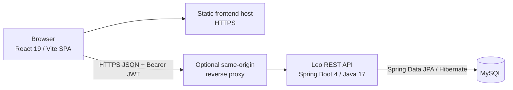
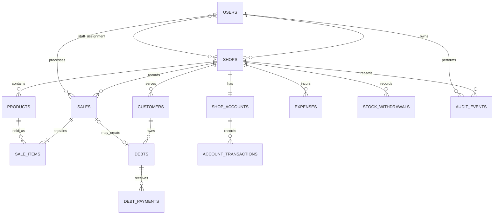

# System Design and Architecture
## Leo — Retail Point of Sale and Shop Operations

| Field | Value |
|---|---|
| Version | 2.0 |
| Status | Current implementation baseline |
| Last reviewed | 2026-11-05 |

This document describes the architecture currently present in the Leo frontend and backend, including limitations that affect production readiness. Product requirements are in the [SRS](SRS_Document.md); endpoint paths and roles are in the [API Reference](../api/API_REFERENCE.md).

## 1. System overview

Leo is split into a browser-based React single-page application and a Spring Boot JSON REST API. The API owns authentication, authorization, business rules, transaction boundaries, and persistence. MySQL stores operational and financial records.



The proxy is optional: the browser may call a separately hosted API using `VITE_API_BASE_URL`, in which case production CORS must allow the frontend's exact origin. The production database must not be publicly exposed. No payment-provider or email-delivery integration is currently part of the application flow.

## 2. Technology and runtime

| Layer | Current technology |
|---|---|
| Frontend | React 19, React Router 7, Vite 8, CSS Modules, `react-icons` |
| API | Java 17, Spring Boot 4.1.x, Spring MVC, Spring Security, Bean Validation |
| Authentication | Signed JWT bearer tokens using JJWT; BCrypt password hashes |
| Persistence | Spring Data JPA / Hibernate; MySQL Connector/J |
| Backend test database | H2 in MySQL compatibility mode |
| API response | JSON `ApiResponse` envelope |
| Health | Spring Boot Actuator health and probe endpoints |

The frontend is an SPA, not currently a PWA or server-rendered React application. It stores the authenticated user and JWT in browser `localStorage`; see the security document for the associated XSS considerations.

## 3. Frontend organization and request flow

The frontend groups screens by product feature under `src/features/`. Shared layout, form, feedback, navigation, branding, and route-protection code lives under `src/components/`; session and feedback state live under `src/context/`.

1. `AuthContext` restores the current session from `leo_user` and `leo_token`.
2. The shared API client sends the bearer token in `Authorization` and adds an `Idempotency-Key` to POST requests.
3. API responses use the common envelope. A 401 dispatches the `leo-auth-expired` event so the session can be cleared.
4. `ProtectedRoute` controls frontend navigation by role; authorization is independently enforced by the API.
5. Feedback components present asynchronous errors, confirmations, and save status to the user.

The configured API base URL is `VITE_API_BASE_URL`. When it is unset, the frontend's local default is `http://localhost:8181`. In production, set an explicit HTTPS URL or route API calls through a same-origin reverse proxy.

## 4. Backend organization

The backend is organized by domain:

```text
com.leo.pos
├── auth/       registration, login, platform setup, token responses
├── admin/      platform tenant summaries and account status
├── security/   JWT filter/service and shop access checks
├── shop/       shop records and owner operations
├── staff/      user accounts, staff and shop assignments
├── product/    product catalogue and stock operations
├── sale/       checkout and sale records
├── customer/   customers, debts, repayments and retention cleanup
├── finance/    expenses, purchases, withdrawals and account ledger
├── dashboard/  owner summary metrics
├── audit/      actor/action audit records
├── productCategories/ product category persistence model
└── root classes: application entry point, SecurityConfig, ApiResponse, GlobalExceptionHandler
```

Controllers validate and route requests. Services enforce domain rules and transaction boundaries. Repositories provide database access. `ShopAccessService` centralizes owner/staff shop-access checks; controllers use the authenticated user principal populated by the JWT filter.

## 5. Authentication and authorization

```mermaid
sequenceDiagram
    participant UI as Browser
    participant API as Auth API
    participant DB as Database
    UI->>API: POST /auth/login (username/email, password)
    API->>DB: Load account and BCrypt hash
    DB-->>API: Account + status
    API-->>UI: User + signed, expiring JWT
    UI->>API: Protected request + Authorization: Bearer JWT
    API->>API: Verify signature and expiration
    API->>DB: Reload account; require ACTIVE status
    API->>API: Apply role and shop-scope checks
    API-->>UI: Authorized response or 401/403
```

- Security is stateless; the API does not use a server-side login session.
- The JWT subject is the user ID. The token defaults to a seven-day expiry, configurable through `jwt.expiration-ms`.
- The server requires a JWT signing secret of at least 32 UTF-8 bytes. Production must supply it through `JWT_SECRET`.
- BCrypt strength is configured as 10.
- `SUPER_ADMIN`, `OWNER`, and `STAFF` are distinct authorities. Staff shop membership is checked from persisted assignments, not from a role supplied by the browser.
- Most routes require authentication. `/auth/**`, `/error`, and actuator health routes are public at the HTTP security layer; platform setup has additional one-time/key/loopback checks in the service.
- CORS allows configured origins and a limited set of methods and headers. Production origins must be explicit, not wildcarded.

## 6. Data ownership and core relationships



Shop ownership and assignment are enforced through server-side relationships. Sale items retain product name, price, quantity, subtotal, and cost snapshots so later catalogue changes do not rewrite historical sale data. Financial records use decimal monetary values; stock quantities are represented by the current product model.

The account ledger records posted cash movements; it is not equivalent to accounting profit. Debt principal is not sales cash, repayment is a cash inflow rather than new revenue, inventory purchases are account outflows rather than immediate operating expenses, and owner drawings are separate from operating expenses. Dashboard and account calculations must preserve these distinctions.

## 7. Transaction and retry behavior

- Checkout locks products in a deterministic order, revalidates shop membership, stock, price and total, then persists sale, stock changes, ledger/debt effects, audit event, and idempotency outcome within the transaction.
- Debt repayment validates the current outstanding amount and updates repayment, debt, ledger, audit, and idempotency records transactionally.
- Expense, stock purchase, stock withdrawal, capital, drawings, and other supported financial mutations enforce service-level authorization and data validation.
- The frontend sends an `Idempotency-Key` for POST requests. High-impact endpoints reserve and complete the key on the server; clients should use a new key for a distinct operation and reuse the same key for retries of one operation.
- Database transaction rollback is the consistency boundary for related writes. External payment-provider confirmation is not performed by this system.

## 8. API and error handling

The current endpoint catalog is maintained in the [API Reference](../api/API_REFERENCE.md). A successful or handled error response follows:

```json
{
  "body": null,
  "message": "Descriptive result",
  "success": false,
  "timeStamp": "2026-11-05T00:00:00Z"
}
```

The global exception handler maps validation, missing-resource, authorization, and unexpected errors to this envelope. Do not rely on implementation-specific database error details as a stable public contract.

## 9. Deployment and configuration

- Development defaults target a local MySQL database and permit local frontend origins.
- Production uses the `prod` profile, required secret/configuration values, TLS-verified database connections, disabled SQL logging, and Hibernate schema validation.
- Production schema changes require reviewed, versioned migrations. The current repository does not include an automatic migration runner or a complete migration history.
- Provide HTTPS, explicit CORS origins, application-only database credentials, backups and tested restoration, health probes, monitoring, and a rollback procedure before public operation.
- See [Production Setup](../deployment/production-setup.md) for environment variables and rollout checks.

## 10. Verification and known limits

Backend tests use H2 and Spring Boot test support. Frontend scripts currently provide Vite build and ESLint; there is no dedicated frontend unit-test runner configured. Build success is not a substitute for browser, API, accessibility, load, or production-database validation.

Known product/runtime limits include no payment gateway, email password-reset flow, subscription billing, notification delivery service, automatic production migration runner, or frontend server rendering. Performance targets and the required measurement procedure are maintained in the [Testing and Performance Plan](../testing/TESTING_AND_PERFORMANCE.md); no performance baseline is claimed by this document.
