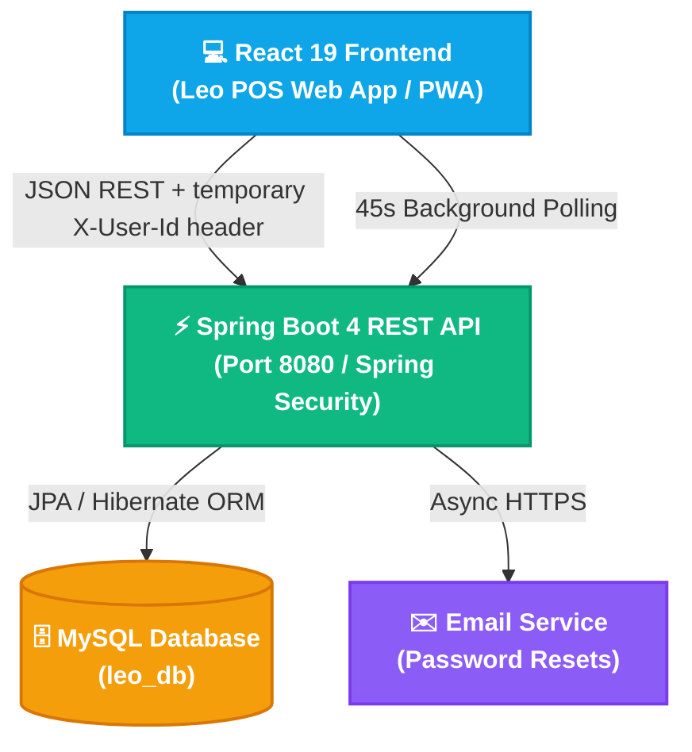
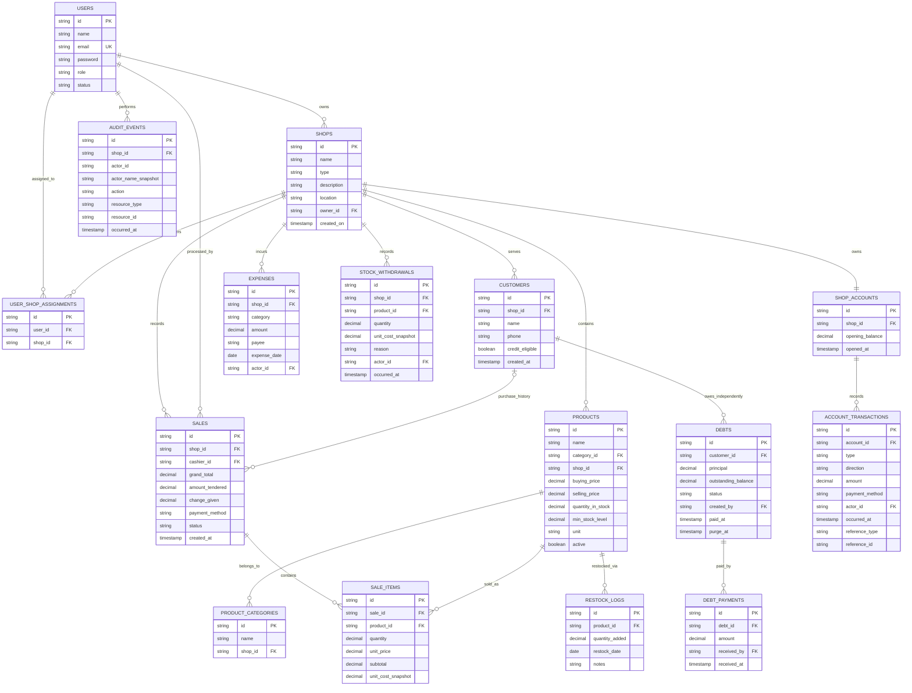
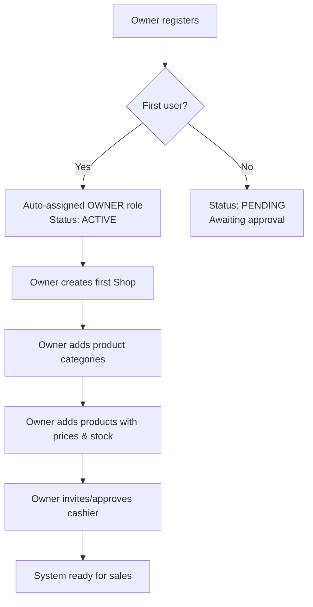
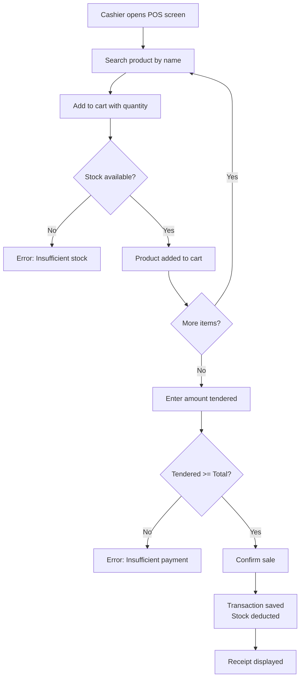
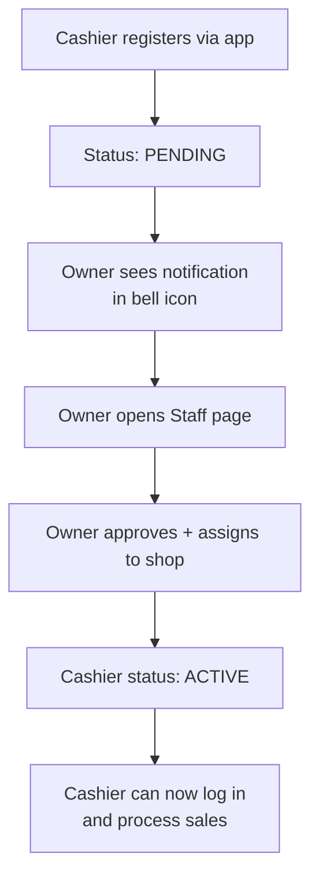
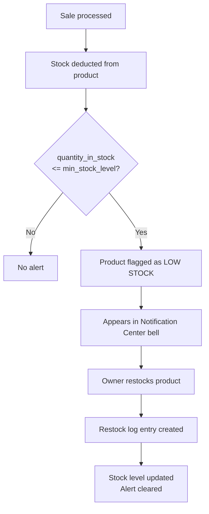

# System Design and Architecture Document
## Leo — Retail Point of Sale (POS) System
**Document Version:** 1.1
**SDLC Stage:** Technical Architecture & MVP Blueprint
**Status:** Updated for financial workflow implementation

---

## 1. Executive Summary & Architectural Overview

**Leo** is built on a decoupled architecture combining a **Spring Boot 4 (Java 17)** REST API backend, a **React 19 (Vite)** single-page web client, and a **MySQL** relational database — mirroring the proven AgroSync architecture pattern.



---

## 2. Backend Package Structure

```
com.leo.pos
├── auth/
│   ├── AuthController.java
│   ├── AuthService.java
│   ├── AuthRequest.java
│   └── PasswordResetToken.java
├── config/
│   ├── SecurityConfig.java
│   ├── CorsConfig.java
│   └── GlobalExceptionHandler.java
├── shop/
│   ├── Shop.java
│   ├── ShopRepository.java
│   ├── ShopService.java
│   └── ShopController.java
├── product/
│   ├── Product.java
│   ├── ProductCategory.java
│   ├── ProductRepository.java
│   ├── ProductService.java
│   └── ProductController.java
├── sales/
│   ├── Sale.java
│   ├── SaleItem.java
│   ├── SaleRepository.java
│   ├── SaleItemRepository.java
│   ├── SaleService.java
│   └── SaleController.java
├── inventory/
│   ├── RestockLog.java
│   ├── RestockLogRepository.java
│   ├── InventoryService.java
│   └── InventoryController.java
├── staff/
│   ├── User.java
│   ├── UserRepository.java
│   ├── UserService.java
│   └── UserController.java
├── dashboard/
│   ├── DashboardService.java
│   └── DashboardController.java
├── customer/
│   ├── Customer.java
│   ├── Debt.java
│   ├── DebtPayment.java
│   └── CustomerService.java
├── finance/
│   ├── Expense.java
│   ├── StockWithdrawal.java
│   ├── ShopAccount.java
│   ├── AccountTransaction.java
│   └── FinanceService.java
├── audit/
│   ├── AuditEvent.java
│   └── AuditService.java
├── security/
│   └── UserIdFilter.java
└── notifications/
    ├── NotificationService.java
    └── NotificationController.java
```

---

## 3. Entity-Relationship Data Model (ERD)



---

## 4. Complete REST API Catalog

| Module | Method | Endpoint | Access | Description |
|:---|:---|:---|:---|:---|
| **Auth** | `POST` | `/auth/register` | Public | Register user (1st user auto-becomes Owner) |
| | `POST` | `/auth/login` | Public | Authenticate and return user payload |
| | `POST` | `/auth/forgot-password` | Public | Send 15-min password reset token via email |
| | `POST` | `/auth/reset-password` | Public | Validate token and reset password |
| **Staff** | `GET` | `/staff` | Owner | List all staff with status and shop assignments |
| | `PATCH` | `/staff/{id}/approve` | Owner | Approve pending cashier and assign role |
| | `PATCH` | `/staff/{id}/deactivate` | Owner | Deactivate a cashier account |
| | `POST` | `/staff/{id}/assign-shop` | Owner | Assign cashier to a shop |
| **Shops** | `POST` | `/shops` | Owner | Create a new shop |
| | `GET` | `/shops` | Owner | List all shops owned by this owner |
| | `GET` | `/shops/{id}` | Owner | Get shop details and summary metrics |
| | `PUT` | `/shops/{id}` | Owner | Update shop name, type, location |
| **Categories** | `POST` | `/shops/{shopId}/categories` | Owner | Create product category for a shop |
| | `GET` | `/shops/{shopId}/categories` | Owner + Cashier | List all categories in a shop |
| **Products** | `POST` | `/shops/{shopId}/products` | Owner | Add product to a shop |
| | `GET` | `/shops/{shopId}/products` | Owner + Cashier | List all products (supports search query) |
| | `GET` | `/shops/{shopId}/products/{id}` | Owner + Cashier | Get single product details |
| | `PUT` | `/shops/{shopId}/products/{id}` | Owner | Update product details or price |
| | `PATCH` | `/shops/{shopId}/products/{id}/deactivate` | Owner | Soft-delete a product |
| **Inventory** | `POST` | `/shops/{shopId}/products/{id}/restock` | Owner | Add stock quantity to a product |
| | `GET` | `/shops/{shopId}/products/{id}/restock-history` | Owner | View restock log for a product |
| | `GET` | `/shops/{shopId}/low-stock` | Owner | List all products below min stock level |
| **Sales** | `POST` | `/shops/{shopId}/sales` | Owner + Cashier | Process a sale (cart checkout) |
| | `GET` | `/shops/{shopId}/sales` | Owner | List paginated sales for a shop |
| | `GET` | `/shops/{shopId}/sales/{id}` | Owner | Get full sale details with line items |
| | `PATCH` | `/shops/{shopId}/sales/{id}/void` | Owner | Void a sale and restore stock |
| **Dashboard** | `GET` | `/dashboard/summary` | Owner | KPIs: revenue today, this month, low stock count |
| | `GET` | `/dashboard/top-products` | Owner | Top 5 products by revenue and quantity |
| | `GET` | `/dashboard/sales-by-shop` | Owner | Revenue breakdown per shop |
| | `GET` | `/dashboard/transactions` | Owner | Paginated recent transactions across all shops |
| **Notifications** | `GET` | `/notifications` | Owner | Aggregate alerts: pending staff, low stock |

---

### Financial and Customer APIs

| Module | Method | Endpoint | Access | Description |
|:---|:---|:---|:---|:---|
| **Customers** | `GET/POST` | `/customers` | Owner + Cashier (shop-scoped) | Search/list customers and create ineligible customer records |
| | `GET` | `/customers/{id}/history` | Owner + Cashier (shop-scoped) | Customer-linked sales and eligibility context |
| | `PATCH` | `/customers/{id}/eligibility` | Owner | Set credit eligibility |
| | `DELETE` | `/customers/{id}` | Owner | Delete customer only without debt records; anonymize linked sales |
| **Debts** | `GET/POST` | `/debts` | Owner + Cashier | List/create independent debts for eligible customers |
| | `POST` | `/debts/{id}/payments` | Owner + Cashier | Record partial/full repayment and account inflow |
| **Expenses** | `GET/POST` | `/expenses` | Owner | List and record dated categorized operating expenses |
| | `GET/POST` | `/expenses/categories` | Owner | Manage shop expense categories |
| **Inventory** | `POST` | `/inventory/withdrawals` | Owner | Record owner-use stock withdrawal atomically with non-cash expense |
| | `POST` | `/inventory/purchases` | Owner | Record quantity and actual cost with stock/account transaction |
| **Accounts** | `GET` | `/accounts/{shopId}/summary` | Owner | Shop cash, net profit, and profit after drawings |
| | `GET` | `/accounts/{shopId}/transactions` | Owner | Paginated account statement |
| | `POST` | `/accounts/{shopId}/capital` | Owner | Record opening capital or capital addition |
| | `POST` | `/accounts/{shopId}/drawings` | Owner | Record owner drawing with cash/profit warnings |

## 5. Core Business Logic

### 5.1 Stock Deduction on Sale
All sale items are processed in a single database transaction:
$$\text{For each SaleItem: } Q_{\text{new}} = Q_{\text{current}} - Q_{\text{sold}}$$
If any item's `Q_requested > Q_current` → entire sale is rejected with HTTP 400.

### 5.2 Change Calculation
$$\text{Change} = \text{Amount Tendered} - \text{Grand Total}$$
If `Amount Tendered < Grand Total` → sale is rejected (insufficient payment for cash).

### 5.3 Grand Total
$$\text{Grand Total} = \sum_{i=1}^{n} (\text{SaleItem}_i.\text{quantity} \times \text{SaleItem}_i.\text{unit\_price})$$

### 5.4 Low Stock Detection
$$\text{Low Stock Alert} \iff Q_{\text{in\_stock}} \le Q_{\text{min\_stock\_level}}$$

### 5.5 Debt, Account, and Profit Boundaries
- Customer debt is a separate receivable and never references or changes a sale. A repayment is a cash inflow, not new sales revenue.
- Repayment and account-ledger updates commit in one transaction. The account inflow is retained without customer/debt references after debt-specific records are purged seven days after settlement.
- Operating profit is sales gross profit less operating expenses (including owner-use stock consumption). Owner drawings reduce cash and remaining profit after drawings, not operating profit.
- Profit summaries include all retained sales and expense records, including records predating shop-account creation. Historical sale costs without a sale-time cost snapshot use the available product cost as an estimate. The cash balance only reflects posted ledger transactions; historical cash must not be inferred from sales, and the owner should enter the actual starting balance as opening capital.
- Shop cash is posted cash inflows less posted cash outflows. Stock purchase principal is an asset acquisition rather than an operating expense; cost of goods sold is recognized from immutable sale-time cost snapshots.
- A drawing greater than remaining profit requires explicit confirmation and a warning; a drawing greater than available cash is rejected.

---

## 6. Security Architecture

### 6.1 Temporary Identity Header (Security Hardening Deferred)
- Login returns the user record. The frontend sends its ID in `X-User-Id`; the backend loads the active user and role from the database. `X-User-Role` is sent for legacy compatibility but is not used as the source of authority.
- This header-based identity can be forged and is not authentication. It is a temporary development bridge only; signed, expiring authentication and deployment secret configuration are deferred to a later security-hardening phase.
- The application does not require `LEO_AUTH_SIGNING_SECRET` to start.
- Passwords are stored as BCrypt hashes (strength 10).

### 6.2 Role & Tenant Enforcement
- Owner-only financial operations are checked using the database-loaded role and service-level ownership checks; because identity comes from a forgeable header, these checks are not a security boundary until the deferred authentication work is completed.
- Cashier shop-scope is checked against server-side assignments for every shop-scoped operation.
- Each finance mutation is transactional and writes its audit event with the database-loaded actor snapshot.
- Settled debt/payment rows and debt-specific audit events are hard-deleted seven days after full repayment. A separate account cash entry remains unlinked so cash reconciliation is not rewritten by retention cleanup.

### 6.3 Global Error Response Format
```json
{
  "body": null,
  "message": "Descriptive error message",
  "success": false,
  "time": "2026-10-13T16:00:00Z"
}
```

### 6.4 Serialization Protection
- `@JsonIgnore` on all bidirectional JPA relationships (`Sale` ↔ `SaleItem`, `Product` ↔ `SaleItem`, `Shop` ↔ `Product`) to prevent Jackson circular recursion.

---

## 7. System Flowcharts

### 7.1 Owner Onboarding Flow


### 7.2 POS Checkout Flow


### 7.3 Cashier Registration & Approval Flow


### 7.4 Low Stock Alert Flow

